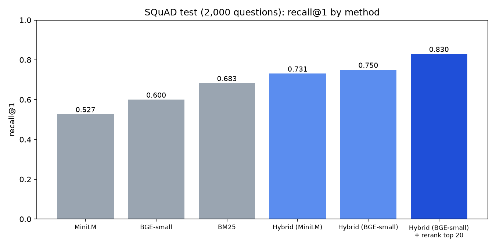

# Retrieval Evaluation on SQuAD: BM25 vs Dense vs Hybrid

Which retrieval method finds the right paragraph for a question: keyword search (BM25), embeddings (MiniLM, BGE-small), or a weighted hybrid? Evaluated with bootstrap intervals on a fixed split.

**TL;DR:** On 2,000 held-out SQuAD questions, a BM25 + BGE-small hybrid with cross-encoder reranking reaches recall@1 0.830 (BM25 alone: 0.683). Differences are tested with paired bootstrap intervals. A light ONNX MiniLM hybrid runs as a [live demo](https://rag-demo-7iru.onrender.com) on a 512 MB free tier.

## Summary

- **Corpus:** 20,958 unique SQuAD v1.1 paragraphs. **Dev:** 500 validation questions (all tuning). **Test:** 2,000 other validation questions, scored once. Seed 42.
- **Result (test):** best overall is the BGE-small hybrid with a cross-encoder rerank of its top 20: recall@1 0.830, MRR 0.881. Best without reranking: hybrid (BM25 + BGE-small) recall@1 0.750, MRR 0.823. MiniLM hybrid 0.731, BM25 0.683, BGE-small 0.600, MiniLM 0.527.
- **Rerank minus hybrid (BGE-small), test:** recall@1 +7.9 points (95% paired interval +6.2 to +9.6), MRR +0.057 (+0.046 to +0.068). The model and cutoff were fixed in advance and test was run once, but only one cross-encoder and one cutoff were tried. Recall@10 moves only from 0.945 to 0.957, because reranking reorders the top 20 and cannot add paragraphs.
- **Hybrid (MiniLM) minus BM25, recall@1:** +4.7 points (95% paired bootstrap interval +3.3 to +6.1).
- **Hybrid (BGE-small) minus BM25, recall@1:** +6.7 points (interval +5.3 to +8.2).
- **Hybrid (BGE-small) minus hybrid (MiniLM):** MRR +0.014 (interval +0.007 to +0.021), recall@1 +2.0 points (interval +0.8 to +3.2). Weighted score fusion scored above reciprocal rank fusion with both embedding models (MRR 0.823 vs 0.802 with BGE-small, 0.810 vs 0.783 with MiniLM); I did not compute a paired interval for that comparison.
- **BM25 minus MiniLM, recall@1:** +15.6 points (interval +13.2 to +18.0). Keyword search clearly beat this dense model.
- **Main limit:** SQuAD questions were written while reading the paragraph, so they reuse its words. This likely favors BM25, but I did not test that.
- **Second dataset (SciFact, 300 test claims):** hybrid nDCG@10 0.717 vs BM25 0.652 (+6.5 points, 95% paired bootstrap interval +4.1 to +8.9). BM25 and MiniLM are close there (0.652 vs 0.648), unlike on SQuAD.

## Results (test set, 2,000 questions)

| Method | recall@1 | recall@5 | recall@10 | MRR |
|---|---|---|---|---|
| BM25 | 0.683 | 0.847 | 0.889 | 0.760 |
| MiniLM (all-MiniLM-L6-v2) | 0.527 | 0.771 | 0.838 | 0.635 |
| BGE-small (bge-small-en-v1.5) | 0.600 | 0.816 | 0.873 | 0.696 |
| Hybrid (w=0.6 on MiniLM) | 0.731 | 0.905 | 0.944 | 0.810 |
| Hybrid, light (ONNX MiniLM + sparse BM25) | 0.732 | 0.904 | 0.942 | 0.811 |
| RRF (k=0, BM25 + MiniLM, ties by BM25 rank) | 0.695 | 0.894 | 0.932 | 0.783 |
| Hybrid (w=0.6 on BGE-small) | 0.750 | 0.912 | 0.945 | 0.823 |
| RRF (k=0, BM25 + BGE-small, ties by BM25 rank) | 0.723 | 0.905 | 0.937 | 0.802 |
| Hybrid 3-way (BM25 0.3, MiniLM 0.3, BGE-small 0.4) | 0.746 | 0.916 | 0.951 | 0.823 |
| Hybrid (w=0.6 on BGE-small) + cross-encoder rerank of top 20 | 0.830 | 0.943 | 0.957 | 0.881 |

95% bootstrap intervals for every row except the light version and the rerank row are printed by `python -m src.row_intervals` (for example recall@1: BM25 0.663 to 0.704, hybrid on BGE-small 0.731 to 0.769, RRF BM25 + BGE-small 0.704 to 0.743). The rerank row's (recall@1 0.812 to 0.846, MRR 0.868 to 0.893) are printed by `python -m src.rerank test`. The light version's are printed by `python -m src.light_eval test` (recall@1 0.712 to 0.751, MRR 0.796 to 0.826). These are unpaired intervals, so overlap between two rows does not test whether they differ; `python -m src.paired_bootstrap` prints paired differences for the BGE-small hybrid and 3-way hybrid only, and `python -m src.rerank test` prints the paired rerank-minus-hybrid difference.

## Live demo and light version

- **Live demo:** https://rag-demo-7iru.onrender.com (free Render instance, so the first load can take a minute). Code: https://github.com/dmatharv25-cmd/rag-demo
- **Light version:** MiniLM runs through ONNX Runtime and BM25 uses precomputed sparse matrices, so the demo needs no torch. On the same test split it scores recall@1 0.732 and MRR 0.811, against 0.731 and 0.810 for the full hybrid. The differences are well inside the bootstrap intervals.
- **Memory:** about 355 MB after loading and about 400 MB after a query, measured locally on Windows. Render's free tier has 512 MB. On Render's free tier, the service stayed live after test queries, with no restart or out-of-memory event in Render's Events tab. I did not read the memory peak there.
- **Latency:** on Render's free tier (0.15 CPU, 512 MB), 12 consecutive queries on the live demo, including 4 repeats of the Rome question, all succeeded and returned in 1.6 to 2.0 s each (mean 1.8 s). Timed from a local machine, so this includes the network round trip. Times did not grow across the run.

## Method

- BM25: rank_bm25 (Okapi), lowercase word tokens.
- Dense: all-MiniLM-L6-v2, cosine similarity on normalized embeddings.
- Dense, second model: BAAI/bge-small-en-v1.5, cosine similarity on normalized embeddings, queries use the model's recommended instruction prefix, passages none, max sequence length 256.
- Fusion: z-scored BM25 and dense scores combined with a weight tuned on dev (grid step 0.1). RRF uses ranks only (k=0 was chosen on dev for BM25 + MiniLM, where k=0 to 3 were nearly tied, and reused for BM25 + BGE-small without a separate grid; ties broken by BM25 rank).
- Rerank: cross-encoder/ms-marco-MiniLM-L-6-v2 (max length 256) rescored the top 20 paragraphs of the BGE-small hybrid. The model and the cutoff of 20 were fixed in advance and nothing was tuned; I checked dev once (recall@1 0.768 to 0.828) and ran test once. Paragraphs outside the top 20 keep their hybrid rank, so recall@10 and above are capped by the top-20 coverage (target inside the top 20 for 96.8% of test questions). Test, recall@1: reranked minus hybrid +7.9 points (95% paired interval +6.2 to +9.6), MRR +0.057 (+0.046 to +0.068). Only this one cross-encoder and this one cutoff were tried.
- Hybrid: per-question z-score of each method's scores across the corpus, then (1-w)*BM25 + w*MiniLM. The weight w=0.6 was chosen on dev by MRR (grid 0.0 to 1.0, step 0.1; 0.5 and 0.6 were nearly tied). Dev MRR at w=0.6 was 0.824, test 0.810.
- No model was trained, so there are no seeds.

## Second dataset: SciFact

Same pipeline on BEIR SciFact (5,183 abstracts, documents are title plus abstract). The 809 train-split claims were used as dev to choose the fusion weight (w=0.7, dev MRR 0.696; 0.689 at 0.6 and 0.692 at 0.8). The 300 test claims were scored once. Here recall@k means at least one relevant document in the top k.

| Method | recall@1 | recall@10 | MRR | nDCG@10 |
|---|---|---|---|---|
| BM25 | 0.523 | 0.797 | 0.624 | 0.652 |
| MiniLM (all-MiniLM-L6-v2) | 0.503 | 0.800 | 0.613 | 0.648 |
| Hybrid (w=0.7 on MiniLM) | 0.593 | 0.847 | 0.691 | 0.717 |

- Hybrid minus BM25: nDCG@10 +6.5 points (95% paired bootstrap interval +4.1 to +8.9), recall@1 +7.0 (+3.3 to +11.0). Hybrid minus MiniLM: nDCG@10 +6.9 (+4.2 to +9.7).
- BM25 and MiniLM are close on SciFact (recall@1 differs by 2.0 points, nDCG@10 by 0.4). On SQuAD BM25 led by 15.6 recall@1 points. This is consistent with the word-overlap explanation for SQuAD, but the domain, task and corpus size also differ, so it does not test that explanation. I did not compute a paired interval for the BM25 vs MiniLM gap on SciFact.
- Intervals are wide (300 test claims, about 5 points either side). The weight was tuned on one dataset at a time, so 0.6 on SQuAD and 0.7 here are separate choices.
- Not checked: whether MiniLM's default sequence length truncates longer abstracts, and how these numbers compare with published BEIR results.
- Run it: `python -m src.scifact_eval` (downloads SciFact from Hugging Face as mteb/scifact; embedding the corpus took about 5 minutes on my CPU).

## Error analysis (test)

- BM25 beat MiniLM on recall@1 in every question type. The hybrid was best or tied in most, not in "when" (tied with BM25) or "why" (below BM25, only 29 questions).
- The hybrid had 112 of 2,000 questions with the right paragraph outside the top 10. Five I read by hand included questions with no content words ("Who discovered this and where did they come from?"), which no retriever could resolve.
- Per-type groups are small (29 to 906 questions), so differences within them are noisy.
- In the live demo, "Who was the first emperor of Rome?" returns a Constantine paragraph at rank 1 and the Augustus paragraph at rank 2. Lexical overlap can outrank the true answer. This is one example, not a measured rate.

## Run it yourself

1. `python -m venv .venv`, activate, `pip install -r requirements.txt`
2. `python -m src.data`
3. `python -m src.bm25_eval dev`, `python -m src.dense_eval dev` (the corpus embedding took about 43 minutes on my CPU), `python -m src.hybrid_dev`
4. `python -m src.bm25_eval test`, `python -m src.dense_eval test`, `python -m src.final_test`, `python -m src.errors`
5. BGE-small and fusion (needs steps 3 and 4 first, since it reads the BM25 and MiniLM score files): `python -m src.bge_eval` (the corpus embedding took about 31 minutes on my CPU), `python -m src.fusion_bge`, `python -m src.paired_bootstrap`
6. BM25 + MiniLM RRF and the BM25 tie check (needs steps 3 and 4): `python -m src.rrf_minilm`
7. Per-row 95% intervals for the table (needs steps 3 to 5): `python -m src.row_intervals`
8. Cross-encoder rerank (needs step 5; downloads the cross-encoder, about 7 minutes on dev and 27 minutes on test on my CPU): `python -m src.rerank dev`, `python -m src.rerank test`

Tested on Windows with Python 3.12 only.

## Light version: run it yourself

Needs the full-pipeline outputs first: steps 1 and 2 above, plus `python -m src.dense_eval dev` once, which builds `data/minilm_corpus_emb.npy`.

1. `python -m src.build_index` builds the sparse BM25 index (`data/bm25_M.npz`, `bm25_idf.npy`, `bm25_vocab.json`).
2. `python -m src.export_onnx minilm_onnx` exports all-MiniLM-L6-v2 to ONNX (inputs `input_ids` and `attention_mask`) and saves the tokenizer files.
3. `python -m src.onnx_check` compares ONNX and torch embeddings on three queries. I got cosine 1.0 on all three.
4. `python -m src.light_eval test` prints recall@1 0.732, recall@5 0.904, recall@10 0.942 and MRR 0.811 with bootstrap intervals.

Embedding recipe: tokenize with truncation at 256 tokens, run the ONNX graph, mean-pool over the attention mask, then L2-normalize. The graph outputs token states only, so pooling and normalization happen in the code.

I rebuilt the ONNX file with this script and re-ran steps 3 and 4. The metrics matched the file used for the demo to three decimals. The two files differ by about 6 KB in size, so they are not byte-identical. The live demo uses the earlier export.

Light version tested with torch 2.14.1, transformers 5.19.0, onnx 1.23.2 and onnxruntime 1.31.0. The export uses the legacy TorchScript exporter and prints tracer warnings, which did not change the results on this corpus.

## What I did not test

- Two dense models (all-MiniLM-L6-v2 and bge-small-en-v1.5, each with its own tokenizer), one weighted score-fusion scheme, and RRF with k=0 (no separate k grid for BGE-small). Larger or retrieval-tuned models, other BM25 settings, other fusion methods, other cross-encoders and other rerank cutoffs were not tried.
- Why BM25 beats MiniLM here (word overlap with the paragraph) is a hypothesis.
- Paragraph-level retrieval only. No answer generation, no passage chunking.
- Dev and test questions can point to the same paragraph.
- SQuAD is Wikipedia text with written questions. Results may differ on real user queries.
- The weight was tuned on 500 questions and was nearly flat between 0.5 and 0.6.
- Ties are ranked optimistically for score-based rows (only strictly higher scores count); RRF breaks ties by BM25 rank. For BM25 this affects 13 of 2,000 test questions and changes no BM25 metric at the precision shown (`python -m src.rrf_minilm` prints the check). I did not run the same check on the other rows.
- Fusion weights were tuned on only 500 dev questions. The 3-way hybrid (66 weight combinations) beat the 2-way on dev (MRR 0.837 vs 0.830) but not on test (difference -0.0003, interval -0.0056 to +0.0051), so it is reported as an ablation only.
- The live demo still runs the MiniLM hybrid. BGE-small was not exported to ONNX and was not run on SciFact.
- BGE queries use the recommended instruction prefix; I did not test without it.
- The cross-encoder (ms-marco-MiniLM-L-6-v2) was trained on MS MARCO web search data, not SQuAD. I did not examine which questions the reranker fixes or breaks, I did not run it on SciFact, and the live demo does not use it (on Render's free tier it would likely be too slow, but I did not measure that).
